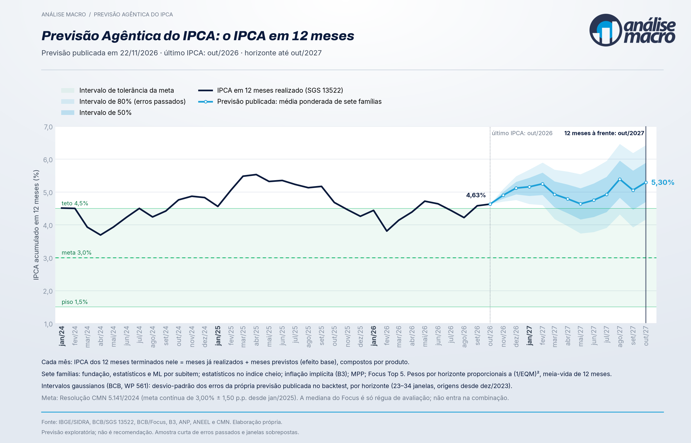

::: {.callout-note}
## 📄 Working paper

Esta é a **ficha técnica do projeto**. Para o *working paper* completo, com resumo, estrutura, como citar e PDF para download, veja [**Previsão Agêntica do IPCA**](../research/ipca-desagregado.html).
:::

{width=100%}

*Atualizado em 22/11/2026: versão 3.1, previsão publicada com sete famílias. Números com dados até o IPCA de out/2026.*

::: {.callout-note}
## Links

- **Painel ao vivo:** [analisemacro.shinyapps.io/ipca-desagregado](https://analisemacro.shinyapps.io/ipca-desagregado/) — previsão atual, comentário do dia, composição por família, desempenho contra o Focus e metodologia
- **Paper (PDF, versão 3.1):** [Previsão Agêntica do IPCA](https://analisemacro.shinyapps.io/ipca-desagregado/paper.pdf)
- Código em repositório privado da Análise Macro.
:::

## A pergunta

O projeto começou com uma pergunta de pesquisa: modelos de fundação de séries temporais,
aplicados sem treino aos 377 subitens do IPCA e agregados com os pesos do IBGE, preveem o
índice melhor que o Focus? A primeira versão terminou num empate, e o diagnóstico do erro
mostrou por quê: no curto prazo, o que separa uma previsão da outra é **informação** —
combustíveis, bandeira tarifária, reajustes regulados, a prévia do IPCA-15 —; do segundo
trimestre em diante, pesam os **modelos**.

A versão atual muda o objetivo: a **melhor previsão fora da amostra** do IPCA de cada mês e do
acumulado em 12 meses, feita com tudo o que estava disponível na data — modelos, preços de
mercado e a pesquisa Focus no recorte dos analistas que mais acertam. A **mediana do Focus** fica
de fora da combinação: é a régua a bater.

## Como funciona

A previsão publicada é a **média ponderada de sete famílias**; cada família é resumida pela
mediana dos seus modelos.

| Família | O que é |
|---|---|
| **Modelos de fundação** | Nove modelos (Chronos-2, TimesFM, TiRex, Moirai, Toto, Granite, TimeGPT), sem treino específico, nos 377 subitens, agregados com os pesos do IBGE |
| **Estatísticos por subitem** | ARIMA, ETS, Theta, ingênuo sazonal e média sazonal nos 377 subitens |
| **ML por subitem com informação externa** | Um LightGBM global para os 377 subitens, um por horizonte, com câmbio, IC-Br, Brent, IBC-Br e desemprego, cada série com o seu atraso de publicação |
| **Estatísticos no índice cheio** | Passeio aleatório, ARMA, VAR e curvas de Phillips: réplica do boxe de *machine learning* do RPM de dez/2025 |
| **Inflação implícita** | Curvas PRE e DIC da B3, com a sazonalidade do IPCA |
| **MPP** | Modelo semiestrutural da Análise Macro, reestimado a cada trimestre com o câmbio da data |
| **Focus Top 5** | Mediana dos cinco melhores do Focus disponível na data |

Três decisões definem o método:

- **Mesma informação para todos.** As famílias por subitem recebem o mesmo bloco institucional
  para os 37 preços administrados (energia com bandeira e Itaipu, combustíveis pela ANP, planos
  de saúde, remédios, regras de reajuste), e as que só olham preços recebem o repasse da
  depreciação recente estimado pelo MPP. A comparação passa a medir o modelo, não a informação.
- **Pesos por horizonte, pela aderência.** Em cada horizonte, peso ∝ (1/EQM)², só com erros já
  conhecidos na data e meia-vida de 12 meses — um caso da regra de Stock e Watson (2004). Na
  origem out/2026, no mês seguinte pesam mais a fundação (31%), o Top 5 (23%) e os estatísticos
  por subitem (21%); a 12 meses, o MPP (26%) e os estatísticos no índice cheio (21%).
- **Atualização a cada informação.** Os três primeiros meses passam por um **nowcast
  incremental**: cada dado novo (ANP, bandeira, bônus de Itaipu, IPCA-15 por subitem, IPC-S de
  fim de mês) entra com o peso do subitem e fica registrado, com data e fonte, na trilha do mês.

## Pipeline agêntico

- **Sensores** verificam IBGE, BCB, ANP, ANEEL e o calendário oficial do IBGE; cada informação
  nova dispara uma rodada no **GitHub Actions** que refaz só o que depende dela (grafo de etapas
  com impressão digital das entradas).
- **Portões de qualidade** (painel completo, frescor dos dados, tamanho da revisão) antes de
  publicar; um vigia re-executa rodadas que falharam e um agente de diagnóstico (Claude) lê o log
  e abre *issue* ou *pull request* com a correção.
- **Coletor no Cloud Run** (São Paulo) espelha ANP e ANEEL, que recusam os servidores do GitHub.
- **Comentário diário** escrito pelo Claude a partir só das evidências calculadas; cada número
  do texto é conferido antes de sair.
- **Publicação** atômica no painel Shiny e no servidor MCP da Análise Macro.

## O que se encontrou

Walk-forward com informação datada, 47 origens (dez/2022 a out/2026), alvos desde jan/2024;
erro quadrático médio da previsão publicada dividido pelo da mediana do Focus:

| Horizonte (meses) | 1 | 2 | 3 | 6 | 9 | 12 |
|---|---|---|---|---|---|---|
| **IPCA do mês** | 0,77 | 1,05 | 0,99 | 0,90 | 0,92 | 0,84 |
| **IPCA em 12 meses** | — | — | 0,89 | 0,79 | 0,70 | 0,82 |

- A previsão erra menos que o Focus no mês seguinte e empata a dois e três meses; no IPCA em 12
  meses, fica abaixo do Focus de três a doze meses à frente. **Nenhuma diferença é significativa a
  5%** (Diebold-Mariano com correção HLN).
- O bloco institucional mudou o quadro dos modelos que só olhavam preços: no mês seguinte, a
  mediana do ML caiu de 3,16 para 0,89 do erro do Focus, e a dos estatísticos, de 3,12 para 1,27.
  A desvantagem desses modelos era informação, não método.
- Escolher entre os 103 modelos individuais pelo erro passado (o Top3 do BC) foi testado e
  perdeu para a combinação por famílias.

## Previsão atual (22/11/2026, último IPCA: out/2026)

- **IPCA do mês:** 0,44% em nov/2026, 0,54% em dez/2026 e 0,37% em jan/2027.
- **IPCA em 12 meses:** 5,12% em dez/2026 e 5,30% em out/2027, com intervalo de 80% de 4,16% a
  6,43%. O centro da previsão fica acima do teto da meta (4,5%) em toda a trajetória.

## Ressalvas

Amostra curta (34 a 47 origens) e janelas sobrepostas; parte do desenho foi escolhida olhando
2024–26. O backtest do MPP usa dados revisados, o que o favorece. O Focus Top 5 entra como insumo:
a combinação é de modelos e pesquisa, não só de modelos.

## Ferramentas

Python (pandas, PyTorch e as bibliotecas de cada modelo, statsforecast, LightGBM), Quarto e LaTeX
para o paper, Shiny for Python no painel (shinyapps.io), GitHub Actions e Google Cloud Run no
pipeline, e Claude Code como agente de desenvolvimento, com regras de projeto que proíbem número
sem fonte e informação do futuro.

*Pesquisa aplicada. Não é recomendação de investimento.*
