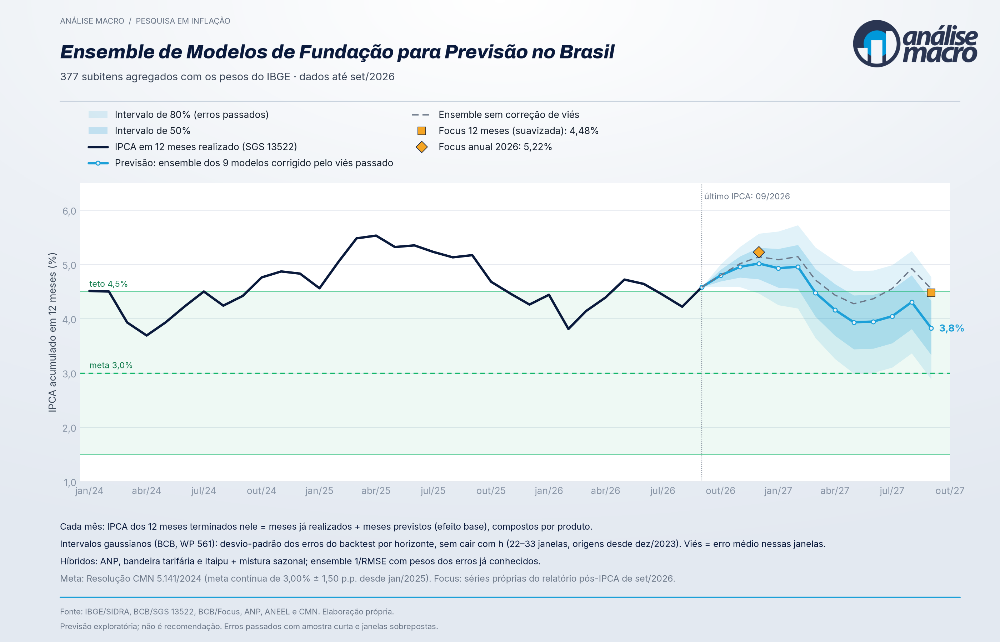

{width=100%}

::: {.callout-note}
## Links

- **Dashboard:** [analisemacro.shinyapps.io/ipca-desagregado](https://analisemacro.shinyapps.io/ipca-desagregado/)
- **Paper (PDF):** [Ensemble de Modelos de Fundação para Previsão da Inflação no Brasil](https://analisemacro.shinyapps.io/ipca-desagregado/paper.pdf)
- Código em repositório privado da Análise Macro.
:::

## A pergunta

O IPCA é a média ponderada de centenas de variações de preço. Prever o índice pelos
componentes é natural, mas exige modelar centenas de séries curtas e heterogêneas, e a
literatura brasileira registra ganhos modestos da desagregação. Os **modelos de fundação**
de séries temporais, redes pré-treinadas aplicadas sem estimação, mudam esse custo: prever
os 377 subitens passa a ser uma única chamada por mês.

O projeto testa se essa previsão desagregada, agregada com os pesos do IBGE, compete com a
mediana do **Boletim Focus** em horizontes de 1 a 12 meses, num desenho em que cada previsão
usa apenas a informação disponível na data.

## Como foi feito

| Etapa | O que entra |
|---|---|
| **Dados** | IPCA por subitem (SIDRA/IBGE, tabela 7060, POF 2017-18, desde jan/2020); IPCA em 12 meses (SGS 13522); expectativas Focus da API Olinda, do relatório publicado logo após cada IPCA, com datas de publicação auditadas |
| **Modelos** | Chronos-2 (com e sem aprendizado entre séries), TimesFM 2.5 e 3, TiRex, Moirai 2.0, Toto, Granite TTM e TimeGPT-1, todos zero-shot, um ambiente Python por família |
| **Ajustes** | Combustíveis pelo levantamento semanal da ANP; energia elétrica pela bandeira tarifária e pelos créditos de Itaipu, só depois de anunciados; mistura com a média sazonal; parâmetros escolhidos apenas com 2023 |
| **Combinação** | Ensemble ponderado pelo inverso do RMSE dos erros já conhecidos, por horizonte; Top3 recursivo do Banco Central como alternativa testada |
| **Avaliação** | Walk-forward com janela expansiva, alvos de jan/2024 a set/2026; Diebold-Mariano com correção HLN contra o Focus; IPCA mensal, em 12 meses e do ano-calendário |
| **Incerteza** | Intervalos gaussianos com a dispersão dos erros passados, crescente no horizonte (WP 561 do BCB), calibrados no backtest; quantis nativos dos modelos avaliados por CRPS |

## O que se encontrou

- **IPCA do mês:** o ensemble empata com o Focus no mês seguinte e erra até 9% menos de 2 a
  12 meses à frente, sem diferença estatisticamente significativa.
- **IPCA em 12 meses:** previsto um ano antes, o ensemble errou menos que o Focus 12 meses no
  período, também sem significância estatística; no ano-calendário, ganhou em 2024 e perdeu
  em 2025.
- **Onde o erro sobra:** poucos preços explicam a maior parte — passagem aérea, gasolina e
  alimentos in natura no mês seguinte; energia elétrica a 3 meses. De 4 meses em diante, os
  preços administrados respondem por cerca de 60% do erro.
- **Incerteza:** os intervalos construídos com os erros passados ficam perto da cobertura
  nominal e superam as distribuições nativas dos modelos, que são largas demais. A correção de
  viés estimada em tempo real piorou a previsão.

## Previsão atual e operação

A cada divulgação do IPCA, um único script refaz a coleta, roda os nove modelos só na origem
nova, aplica os ajustes, recalcula o ensemble e os intervalos, atualiza o paper (com todos os
números gerados a partir das saídas) e publica o dashboard. Cada rodada é gravada num registro
que só recebe acréscimos: o histórico das previsões feitas em tempo real, separado do backtest.

O dashboard tem menus para a previsão atual, o erro mês a mês contra o Focus, o IPCA em 12
meses e do ano, a calibração da incerteza, a decomposição do erro por subitem e segmento, o
registro das rodadas e a metodologia.

## Ferramentas

Python (pandas, PyTorch e as bibliotecas de cada modelo), Quarto e LaTeX para o paper, Shiny
for Python com plotnine no dashboard (shinyapps.io), e Claude Code como agente de
desenvolvimento, com regras de projeto que proíbem número sem fonte e informação do futuro.

*Pesquisa exploratória: amostra curta, parte do desenho definida depois de observar 2024–26.
Não é recomendação de investimento.*
