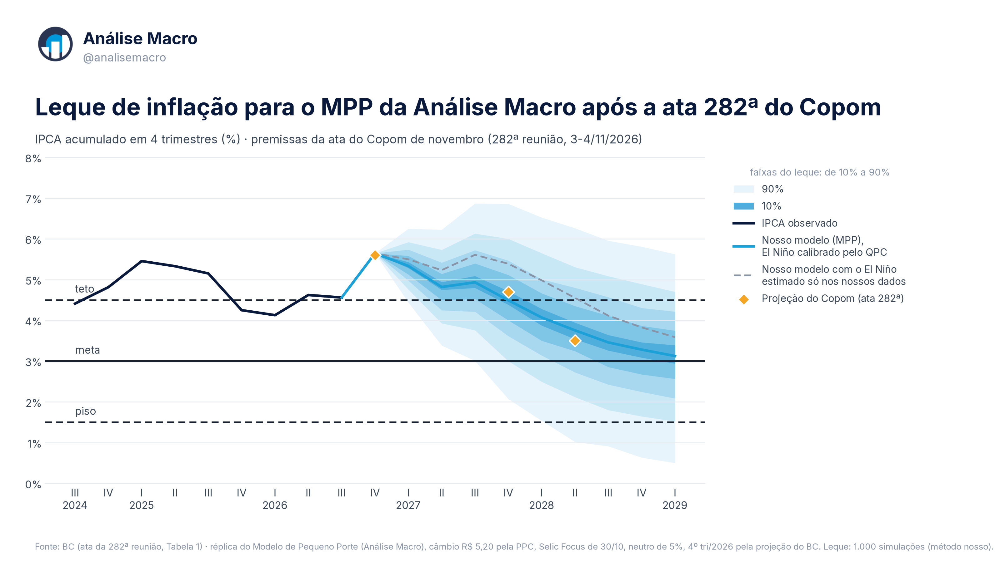

{width=100%}

*Atualizado em 16/11/2026 com as premissas da ata da 282ª reunião do Copom.*

::: {.callout-tip}
## Experimente agora

O servidor MCP está no ar, é **público e gratuito**. Cole esta URL como conector
personalizado no Claude (Configurações → Connectors) e peça *"projete a inflação
com a Selic a 12,5% e o câmbio a R$ 5,60"*:

```
https://mpp-mcp.analisemacro.workers.dev/mcp
```

O passo a passo está na [seção final desta página](#usando-o-mcp).
:::

## O problema

O Banco Central projeta a inflação com um conjunto de modelos. O mais transparente
deles é o **Modelo de Pequeno Porte** (MPP): um modelo semiestrutural
deliberadamente parcimonioso, cuja função é menos prever com máxima acurácia do
que organizar de forma clara o raciocínio condicional que sustenta a decisão de
política monetária.

O BCB publica a estrutura das equações nos boxes dos Relatórios de Inflação e,
desde 2020, as tabelas de parâmetros estimados. Mas **não publica o código nem a
base de dados**. Para quem quer usar o modelo — e não apenas ler suas projeções —
isso é uma parede.

Este projeto atravessa essa parede: reconstrói o modelo em Python, mede o quão
perto se chega das projeções oficiais, e expõe o motor como uma ferramenta que
qualquer pessoa pode usar conversando com uma IA.

---

## O modelo

Sete equações estimadas, ligadas por identidades contábeis, em frequência trimestral.

| Bloco | Papel |
|---|---|
| **Curva IS** | Hiato do produto responde ao juro real |
| **Curva de Phillips** | Inflação de preços livres |
| **Expectativas** | Inércia, inflação passada e a projeção do próprio modelo, ancoradas na meta |
| **Regra de Taylor** | Selic reage ao desvio das expectativas em relação à meta |
| **Paridade de juros** | Câmbio reage ao diferencial de juros |
| **Preços administrados** | Repasse do petróleo em reais |
| **Sazonalidade** | Dessazonalização dos preços livres |

O que distingue esta versão: **Selic, câmbio e preços administrados são
endógenos**. Isso significa que o modelo os projeta sozinho, em vez de recebê-los
como hipótese — e cria um bloco simultâneo dentro do trimestre, em que o hiato
depende do juro real, o juro real da Selic e das expectativas, a Selic das
expectativas, e o câmbio do diferencial de juros.

As expectativas seguem a forma que o Banco Central descreve nos seus boxes: em
desvio da meta, com inércia, com a inflação passada e com a inflação que o próprio
modelo projeta. A inércia estimada aqui, 0,77, é praticamente a do BCB, 0,75.

A consequência econômica é direta: um aperto monetário passa a **apreciar o
câmbio**, e a apreciação realimenta a inflação. O canal cambial de transmissão,
ausente quando o câmbio é exógeno, torna-se operante.

A base é recoletada das fontes primárias — Banco Central, IBGE, FRED, NOAA —, o
que torna o exercício **atualizável**: o modelo roda com os dados de hoje.

---

## Os resultados

### Validação econômica

O teste mais exigente disponível é comparar o modelo com o que o Banco Central
publica sobre o seu:

| Medida | Modelo | BCB |
|---|---|---|
| Selic +1 p.p. por 4 trimestres, depois a regra de Taylor | **−0,27 p.p.**, no 5º trimestre | −0,27 (agregado) e −0,24 (desagregado), no 4º |
| Inércia das expectativas | **0,77** | 0,75 |
| Reação da Selic ao desvio das expectativas | **1,71** | 1,30 – 2,03 |

O experimento de juros é o padrão dos boxes do BCB: a Selic sobe um ponto por
quatro trimestres e depois volta a seguir a regra de Taylor. O efeito máximo no
IPCA em doze meses cai dentro da faixa publicada, e o caminho passa pelos mesmos
canais: hiato, câmbio e expectativas que cedem devagar.

### Com as premissas do Relatório de setembro

O Apêndice metodológico do Relatório de Política Monetária descreve os
condicionantes: Selic da pesquisa Focus, câmbio pela paridade do poder de compra,
petróleo, inflação externa e juro neutro de 5%. Com eles, e com o primeiro
trimestre fixado pela projeção do BCB, como ele faz no curto prazo:

| IPCA em 4 trimestres | 2026 | 2027 | 1º tri/2028 |
|---|---|---|---|
| BCB (RPM set/2026) | 5,2% | 3,9% | 3,2% |
| Modelo | 5,2% | 4,0% | 3,6% |

O erro absoluto médio nos dez trimestres da tabela oficial é de **0,19 ponto**, com
viés praticamente nulo. As probabilidades de o IPCA passar do teto ficam próximas
das publicadas: 37% em 2027 e 18% em 2028 no modelo, contra 33% e 16% no Relatório.

### Depois da ata da 282ª reunião do Copom

Em novembro, o Copom atualizou o cenário: câmbio partindo de R$ 5,20, Selic do
Focus mais alta e petróleo em queda. A ata publica três pontos da projeção:

| IPCA em 4 trimestres | 2026 | 2027 | 2º tri/2028 |
|---|---|---|---|
| Copom (ata 282ª) | 5,6% | 4,7% | 3,5% |
| Modelo | 5,6% | 4,5% | 3,8% |

O ano de 2026 coincide por construção. Em 2027 o modelo fica 0,2 ponto abaixo, e
no horizonte relevante, 0,3 ponto acima. Pelo leque, a chance de o IPCA passar do
teto é de 52% em 2027 e de 21% em 2028.

### O El Niño decide boa parte do número

O episódio de 2026 é intenso, e o seu efeito é a premissa mais sensível. Estimado
só com os nossos dados, ele leva o IPCA a 5,4% em 2027; sem o choque, a 4,2%. A
versão do gráfico calibra o efeito pela evidência que o próprio BCB publicou: no
Questionário Pré-Copom, a mediana dos analistas é de 0,85 ponto em dois anos para
um El Niño como o de 2014-15.

---

## A distância honesta

Cabe uma ressalva, porque a tentação de apresentar o resultado como "a projeção do
Banco Central" é real — e seria incorreto.

**Este não é o modelo vigente do BCB.** Desde 2020, o Banco Central estima o hiato
do produto e o juro real neutro como **variáveis latentes**, com estimação
bayesiana do sistema inteiro. Aqui, as equações são estimadas uma a uma, e o hiato
e o neutro vêm de filtros estatísticos. A estrutura das equações é a do modelo
atual; a estimação é a da tradição anterior.

Três escolhas também são nossas, e não do BCB: o primeiro trimestre fixado pela
projeção oficial, o tamanho do efeito do El Niño e o método do leque e das
probabilidades, que o Banco Central não publica.

As projeções produzidas aqui **não são** as do Banco Central e não devem ser
apresentadas como tais. A proximidade medida acima mostra que a estrutura captura o
essencial do mecanismo de transmissão.

---

## Usando o MCP {#usando-o-mcp}

O motor do modelo está exposto como **servidor MCP** — o padrão aberto que permite
a um assistente de IA chamar ferramentas externas. Na prática: você conversa com o
Claude, informa as premissas, e ele devolve a projeção e o **gráfico pronto** para
colar no relatório.

::: {.callout-note}
## Por que isso importa

Sem MCP, se você pedir uma projeção de inflação ao Claude, ele responde com o que
"lembra" — e pode inventar um número plausível. Com ele, o Claude **roda o modelo
de verdade** e devolve o resultado.
:::

### Conectar

No Claude, vá em **Configurações → Connectors → Adicionar conector personalizado**
e cole:

```
https://mpp-mcp.analisemacro.workers.dev/mcp
```

Se aparecerem quatro ferramentas com o prefixo `mpp_`, está funcionando. Não
precisa de senha, cadastro nem instalação. O mesmo endereço funciona em qualquer
cliente que fale MCP — Cursor, Codex, VS Code.

### O que dá para pedir

Comece pelo simples, para ver o cenário de referência:

> *"O que o modelo de pequeno porte projeta para a inflação?"*

Depois informe suas próprias hipóteses — que é o ponto do exercício:

> *"Projete a inflação supondo a Selic a 12,5% e o câmbio a R$ 5,60."*

> *"E se o petróleo subir para US$ 110 e o risco-país for a 220 pontos?"*

> *"Faça a projeção com a Selic caindo gradualmente: 14, 13,5, 13, 12,5 e 12%."*

Note a última: quando você dá uma **lista**, cada valor vale para um trimestre. Um
número único vale para todo o horizonte.

Para o gráfico:

> *"Faça um gráfico de leque dessa projeção."*

E para comparar cenários:

> *"Compare um cenário com a Selic a 14% contra outro a 11%."*

### As premissas aceitas

| Premissa | Unidade |
|---|---|
| Selic | % ao ano |
| Câmbio | R$/US$ |
| Petróleo Brent | US$/barril |
| Inflação americana | % no trimestre |
| Juro básico americano | % ao ano |
| Risco-país (CDS 5 anos) | pontos-base |
| Juro real neutro | % ao ano |
| Âncora de inflação de longo prazo | % |
| Pressão em cadeias globais | desvios-padrão |
| Oceanic Niño Index | °C |

Você não precisa decorar os nomes — basta descrever em português. O que não for
informado segue o cenário de referência.

### O detalhe que muda a interpretação

Este é o ponto mais importante para quem for usar.

**Selic e câmbio são variáveis endógenas.** Se você não informar nada, o modelo as
**projeta sozinho** e elas aparecem como *resultado*. Quando você **informa** uma
trajetória de Selic, está **suspendendo** a regra de Taylor: o que sai não é mais
"o que o modelo prevê", e sim "o que aconteceria com a inflação **se** a Selic
seguisse esse caminho".

A distinção importa na hora de comunicar. Um exemplo concreto: se você impuser uma
Selic mais baixa do que a regra estimada recomendaria, o modelo devolve inflação
mais alta e crescente — não porque esteja errado, mas porque você pediu exatamente
isso.

### Um roteiro de dez minutos

1. *"O que o modelo de pequeno porte projeta para a inflação?"*
2. *"Me explica esse modelo e suas limitações."*
3. *"Projete com a Selic a 12,5% e o câmbio a R$ 5,60."*
4. *"Faça um gráfico de leque dessa projeção."*
5. *"Compare esse cenário com um de Selic a 15%."*
6. *"Por que a inflação sobe quando a Selic cai nesse modelo?"*

A última pergunta é a mais interessante: o assistente consegue explicar o
mecanismo de transmissão — juro real menor, hiato mais aberto, pressão na curva de
Phillips — em vez de apenas repetir números.

---

## O curso

A leitura de um modelo como este — de onde vem cada premissa, o que significa um
leque, por que as expectativas demoram a ceder e o que mudou no BCB em 2020 — é o
assunto do curso **Modelos do Banco Central**, com turma ao vivo a partir de
5 de dezembro de 2026.

[Conheça o curso](https://analisemacro.com.br/curso/modelos-do-banco-central/?utm_source=portfolio&utm_medium=projeto&utm_campaign=modelos-bc&utm_content=mpp-bcb)
