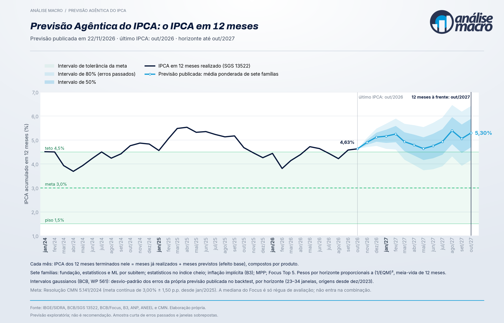

::: {.callout-note}
## Working paper · versão 3.1 · 22/11/2026

O paper descreve a metodologia da previsão publicada (sete famílias) e do pipeline de atualização: as famílias de modelos, o bloco institucional comum, a regra de combinação por horizonte, o respaldo na literatura e a operação agêntica. **Comentários e críticas são muito bem-vindos**: escreva para [vitorwilher@analisemacro.com.br](mailto:vitorwilher@analisemacro.com.br).
:::

<div style="text-align: center; margin: 2em 0;">
[**📄 Baixar PDF (versão 3.1)**](previsao_agentica_ipca.pdf){.btn .btn-primary role="button" style="font-size: 1.1em; padding: 0.8em 2em;"}
[**📊 Painel ao vivo**](https://analisemacro.shinyapps.io/ipca-desagregado/){.btn .btn-outline-primary role="button" style="font-size: 1.1em; padding: 0.8em 2em;"}
</div>

{width=100%}

---

## Resumo

Este trabalho descreve a Previsão Agêntica do IPCA, a previsão da inflação brasileira publicada pela Análise Macro, que se atualiza sozinha a cada informação nova. A previsão é a média ponderada de sete famílias: modelos de fundação de séries temporais e modelos estatísticos aplicados aos 377 subitens do IPCA; um modelo de aprendizado de máquina global por subitem com câmbio, commodities e atividade; modelos estatísticos no índice cheio, inclusive os do boxe de aprendizado de máquina do Banco Central; a inflação implícita nas curvas da B3; o modelo semiestrutural da Análise Macro (MPP), reestimado só com o que se sabia em cada data; e o Focus Top 5. A mediana do Focus é a régua de avaliação, não um insumo. Três decisões definem o método. Primeiro, as famílias por subitem recebem o mesmo bloco institucional de preços administrados, e as que só olham preços recebem o repasse da depreciação recente estimado pelo MPP. Segundo, os pesos de cada horizonte seguem o inverso do quadrado do erro recente de cada família, com meia-vida de 12 meses — um caso da regra de Stock e Watson (2004). Terceiro, um pipeline orientado a eventos detecta cada divulgação, recalcula só o que ela afeta, passa por portões de qualidade e publica; um agente (Claude) escreve o comentário diário com cada número conferido. Num *walk-forward* com informação datada, com alvos desde 2024, o erro quadrático da previsão do mês é 0,77 do da mediana do Focus no mês seguinte e 0,84 doze meses à frente, com empate em dois e três meses; no IPCA em 12 meses, fica entre 0,70 e 0,89 de três a doze meses à frente. Nenhuma diferença é significativa a 5%, a amostra é curta e parte do desenho foi escolhida olhando esse período.

**Palavras-chave:** inflação; previsão autoral; modelos de fundação; combinação de previsões; *nowcasting*; agentes de IA; IPCA.

---

## Estrutura do paper

1. **Introdução**
2. **O IPCA: um índice agregado** — breve história, regime de metas e como o índice é construído
3. **Dados e regra de não vazamento**
4. **As sete famílias** — modelos de fundação nos subitens, estatísticos por subitem, aprendizado de máquina por subitem com informação externa, estatísticos no índice cheio, inflação implícita, MPP mês a mês, Focus Top 5 e o repasse cambial
5. **Bloco institucional comum** — os preços administrados
6. **A previsão publicada: combinação por horizonte** — regra de combinação, por que famílias e não modelos, como se chegou às sete famílias e desempenho
7. **Respaldo na literatura**
8. **Pipeline de atualização: a previsão agêntica** — eventos e sensores, rodada incremental, *nowcast* do mês, véspera com o IPCA-15, IPC-S, radar das pressões, o agente e os portões de qualidade
9. **O modelo estrutural no painel**
10. **Previsão atual**, **Limitações e próximos passos** e **Conclusão**

---

## Como citar

```bibtex
@unpublished{wilher_2026_ipca_desagregado,
  author    = {Wilher, Vitor},
  title     = {Previs\~ao Ag\^entica do {IPCA}},
  note      = {Working paper, vers\~ao 3.1},
  year      = {2026},
  month     = {nov},
  url       = {https://vitorwilher.github.io/research/ipca-desagregado.html}
}
```

---

## Versões anteriores

- **Versão 2.0 (11/11/2026):** [Ensemble de Modelos de Fundação para Previsão da Inflação no Brasil (PDF)](ipca_desagregado_modelos_fundacao.pdf) — nove modelos de fundação nos 377 subitens, com ajustes para combustíveis e energia, combinados num ensemble contra o Focus.

---

## Veja também

- 🛠️ **Ficha técnica do projeto**: [Previsão Agêntica do IPCA — projeto](../projetos/ipca-desagregado.html)
- 📊 **Painel ao vivo**: [analisemacro.shinyapps.io/ipca-desagregado](https://analisemacro.shinyapps.io/ipca-desagregado/)
- 📄 **Paper online (versão mais recente)**: [analisemacro.shinyapps.io/ipca-desagregado/paper.pdf](https://analisemacro.shinyapps.io/ipca-desagregado/paper.pdf)

::: {.text-muted style="font-size: 0.85em;"}
*Dados: SIDRA/IBGE (tabela 7060 e IPCA), BCB (SGS e API Olinda de expectativas do Focus), B3, ANP, ANEEL, FGV (IPC-S) e IPEADATA. O código é mantido em repositório privado da Análise Macro.*
:::
