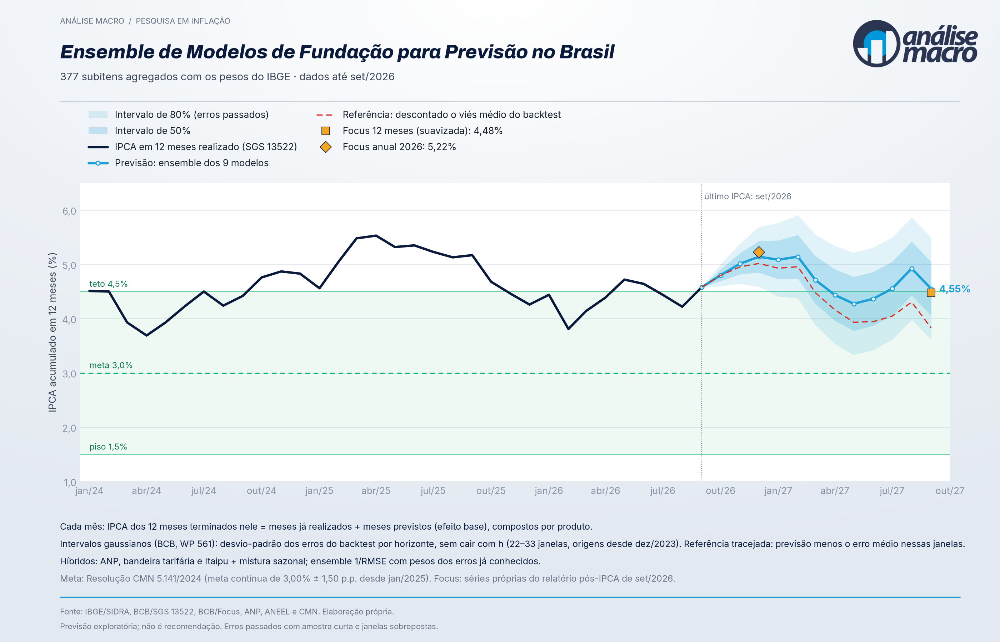

::: {.callout-note}
## Working paper · versão 2.0 · resultados exploratórios

O paper conta o percurso da pesquisa decisão a decisão, à luz da literatura: a história do IPCA, a dos modelos de fundação, os nove modelos usados e os resultados num *walk-forward* com datas de divulgação do IBGE e de publicação do Focus auditadas. **Comentários e críticas são muito bem-vindos**: escreva para [vitorwilher@analisemacro.com.br](mailto:vitorwilher@analisemacro.com.br).
:::

<div style="text-align: center; margin: 2em 0;">
[**📄 Baixar PDF (versão 2.0)**](ipca_desagregado_modelos_fundacao.pdf){.btn .btn-primary role="button" style="font-size: 1.1em; padding: 0.8em 2em;"}
[**📊 Dashboard ao vivo**](https://analisemacro.shinyapps.io/ipca-desagregado/){.btn .btn-outline-primary role="button" style="font-size: 1.1em; padding: 0.8em 2em;"}
</div>

{width=100%}

---

## Resumo

O IPCA é um índice agregado de 377 subitens. Este trabalho testa se nove modelos de fundação de séries temporais, usados sem treino, conseguem prever esses subitens bem o bastante para que a soma ponderada compita com o Focus, e conta o percurso da pesquisa decisão a decisão, à luz da literatura. Os modelos preveem os 377 subitens; as previsões são agregadas com os pesos do IBGE, ajustadas para combustíveis (ANP) e energia (bandeira e créditos de Itaipu), misturadas à média sazonal e combinadas num ensemble ponderado pelo inverso do RMSE passado. Num *walk-forward* com informação datada, o ensemble tem erro igual ao do Focus no mês seguinte (razão de RMSE 1,009) e de 0,911 a 0,998 do erro do Focus de 2 a 12 meses à frente, sem diferença significativa. Intervalos gaussianos construídos com os erros já conhecidos em cada data ficam perto da cobertura nominal, mas a correção de viés em tempo real piora a previsão. Com dados até set/2026, o ensemble projeta o IPCA em 12 meses em 5,14% em dez/2026 e 4,55% em set/2027, acima do teto da meta.

**Palavras-chave:** inflação; modelos de fundação; previsão desagregada; Focus; IPCA.

---

## Estrutura do paper

1. **Introdução**
2. **O IPCA: um índice agregado** — breve história, como o índice é construído e por que prever pelos componentes
3. **Modelos de fundação para séries temporais** — das redes recorrentes à atenção, o que é um modelo de fundação, a chegada às séries temporais e a previsão probabilística
4. **Os nove modelos usados** — Chronos-2 (isolado e com aprendizado entre séries), TimesFM 2.5, TimesFM 3.0, TiRex, Moirai 2.0, Toto, Granite TTM r2 e TimeGPT-1
5. **Dados e desenho** — SIDRA/IBGE (tabela 7060, jan/2020 a set/2026) e Focus/BCB por *vintage*
6. **O percurso da pesquisa** — modelos puros, ganho da desagregação, diagnóstico do erro, informação institucional (combustíveis e energia), combinação, auditoria das datas e medida da incerteza
7. **Resultados** — IPCA do mês, onde o erro sobra e incerteza
8. **Previsão atual**
9. **Limitações** e **Conclusão**

---

## Como citar

```bibtex
@unpublished{wilher_2026_ipca_desagregado,
  author    = {Wilher, Vitor},
  title     = {Ensemble de Modelos de Funda\c{c}\~ao para Previs\~ao
               da Infla\c{c}\~ao no Brasil},
  note      = {Working paper, vers\~ao 2.0},
  year      = {2026},
  month     = {nov},
  url       = {https://vitorwilher.github.io/research/ipca-desagregado.html}
}
```

---

## Veja também

- 🛠️ **Ficha técnica do projeto**: [IPCA Desagregado — projeto](../projetos/ipca-desagregado.html)
- 📊 **Dashboard ao vivo**: [analisemacro.shinyapps.io/ipca-desagregado](https://analisemacro.shinyapps.io/ipca-desagregado/)
- 📄 **Paper online (versão mais recente)**: [analisemacro.shinyapps.io/ipca-desagregado/paper.pdf](https://analisemacro.shinyapps.io/ipca-desagregado/paper.pdf)

::: {.text-muted style="font-size: 0.85em;"}
*Dados: SIDRA/IBGE (tabela 7060) e API Olinda de expectativas do BCB (Focus). O código é mantido em repositório privado da Análise Macro.*
:::
